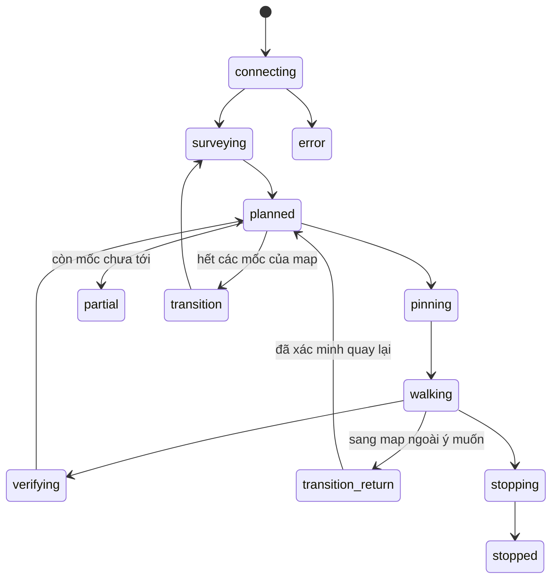

# Quy trình vận hành tool khảo sát map

## Mục tiêu

Tool ghi nhận tiến độ theo tọa độ thật của nhân vật, map và hồ sơ thiết bị. Một mốc chỉ được đánh dấu hoàn thành sau khi telemetry mới xác nhận nhân vật đã đứng trong vùng đích. Nếu còn mốc chưa tới, tool lưu tiến độ và giữ nhiệm vụ ở trạng thái dở dang.

## Trạng thái nhiệm vụ



Các trạng thái kết quả của map có ý nghĩa riêng:

- `complete`: mọi mốc tuyến đã tới và độ phủ kiểm tra hình ảnh đạt tiêu chí đã hiệu chuẩn.
- `route_complete`: đã tới mọi mốc tuyến; độ phủ hình ảnh chưa đủ bằng chứng để xác nhận toàn mặt đất.
- `partial`: còn mốc chưa tới, dữ liệu vị trí không đủ mới, hoặc cần quay lại map.

## Hiệu chuẩn phạm vi quan sát

1. Vào khu vực map thoáng, tránh đứng cạnh cổng hoặc vùng bị che.
2. Đo bán kính quan sát bằng đơn vị tọa độ game tại đúng bốn vị trí cách xa nhau.
3. Mở **Hiệu chuẩn vùng**, nhập cả bốn số đo và chỉ bật xác nhận khi đã kiểm tra chúng trên map thật. Tool dùng số nhỏ nhất làm bán kính an toàn.
4. Sau khi lưu, tool áp dụng hiệu chuẩn cho các map tiếp theo. Map hiện tại chỉ tăng phần đã kiểm tra từ các frame mới; dữ liệu cũ không được tự suy diễn thành đã quan sát.

Nếu chưa có số đo đáng tin cậy, để hiệu chuẩn tắt. Tool vẫn ghi vệt đi và tiến độ mốc nhưng không báo đã kiểm tra toàn bộ mặt đất.

## Theo dõi hiệu năng

Giao diện hiển thị P95; báo cáo lưu P50/P95 cho telemetry, chụp ảnh, lệnh điều khiển và lập tuyến. Thu thập một phiên bình thường trước khi đổi chu kỳ đọc hoặc chụp ảnh; chỉ tối ưu khi P95 cho thấy một thao tác là nút thắt. Dữ liệu hiệu năng được lưu theo phiên và giới hạn số mẫu trong bộ nhớ.

## Xử lý vùng đi lặp và dữ liệu cũ

- Độ mới của vị trí được đối chiếu với thời gian ghi tệp trên LD. Đọc được một bản ghi `stand` cũ không có nghĩa nhân vật đang ở trong game.
- Đường rút gọn phải giữ chi phí địa hình mà A* đã tính. Một ô nhìn được trên ảnh map vẫn có thể thuộc vùng cần tránh.
- Khi cần lùi, tool chỉ dùng vệt liên tục vừa xác minh, giữ các điểm ngoặt, tối đa 4 bước và 12 giây. Không ghim thẳng tới một điểm cũ ở phía bên kia vách; thiếu vệt đủ rõ thì giữ mốc chưa hoàn thành.
- Mặc định, sau 2 lượt thất bại trong bán kính 4 đơn vị mà không thêm mốc mới, tool lưu phần còn thiếu và dừng ở trạng thái `partial`. Vùng thất bại được lưu qua lần mở lại, có thời hạn 600 giây. Ra khỏi vùng đó, có thêm tiến độ xác minh hoặc hết thời hạn thì có thể thử tiếp.
- Bấm Dừng chặn các lệnh thường còn chờ trong kênh gửi. Lệnh hủy vẫn được phép chạy; tool chờ lệnh hủy kết thúc và xác minh vị trí trước khi báo đã dừng.

Các giới hạn nằm trong nhóm `traversal` của `config/settings.json`. Đây là cơ chế phục hồi có giới hạn, chưa phải dữ liệu va chạm đầy đủ của game.

### Kiểm tra trực tiếp bằng cửa sổ tool

Đóng bình thường cửa sổ tool đang mở rồi chạy:

```powershell
python -B tests/live_gui_validation.py --seconds 150 --arrivals 2
```

Bài này mở giao diện thật, giữ nguyên map, thử tạm dừng/tiếp tục, tới các chặng, dừng, nạp lại tiến độ rồi dừng lần cuối. Nó lưu `reports/gui_review/result.json`, chụp riêng cửa sổ tool và để cửa sổ mở sau khi kiểm tra. Lỗi callback giao diện làm kết quả không đạt. Cần xem riêng từng mục kiểm tra; không dùng kết quả bài ngắn để xác nhận toàn map hoặc chạy bền nhiều giờ.

### Bài chạy dài có giới hạn

```powershell
python -B tests/live_ld_validation.py --phase mission --seconds 300 --arrivals 3 --soak --label soak_5m
```

Bài này giữ nguyên map hiện tại, không tự chuyển map, ghi P50/P95 và RAM/CPU tiến trình LD mỗi 60 giây, rồi gửi lệnh dừng và xác minh nhân vật đứng yên. Kết quả `map_complete: null` có nghĩa bài chạy chỉ đo ổn định phiên, chưa nghiệm thu toàn map.

### Thử khôi phục tiến độ

Chạy bài mission có thời hạn với một `--label`, để tool dừng và lưu, rồi chạy lại đúng `--label` đó. Kiểm tra mốc `done` được giữ nguyên, mốc đang đi được đưa lên trước và map không tự chuyển khi còn mốc thiếu.

### Nghiệm thu trọn một map

```powershell
python -B tests/live_ld_validation.py --phase mission --full-map --label full_map_acceptance
```

Chế độ này không tự chuyển sang map khác. Kết quả đạt chứng minh mọi mốc tuyến đã tới; độ phủ hình ảnh chỉ được xác nhận riêng sau khi đã hiệu chuẩn bằng số đo thật và đạt ngưỡng.

## Kiểm tra trước khi phát hành

- Chạy toàn bộ unit test.
- Trên LD đã chọn, xác minh kết nối, đọc map và đọc tọa độ mới.
- Chạy một map nhỏ; kiểm tra thứ tự vòng, mốc đã tới, mốc bị hoãn và phần trăm phủ.
- Thử tạm dừng, tiếp tục, dừng và đóng cửa sổ; xác nhận joystick được nhả và trạng thái dừng được ghi.
- Mở cổng thử nghiệm nếu có trong cấu hình; xác nhận map nguồn còn dở được lưu và tool quay lại hoặc dừng an toàn.
- Khởi động lại tool; xác nhận tiếp tục đúng hồ sơ/map và không tạo phiên điều khiển trùng.
- Kiểm tra P95 và log sau phiên; giữ nguyên cấu hình nếu chưa có số đo chứng minh cần thay đổi.
